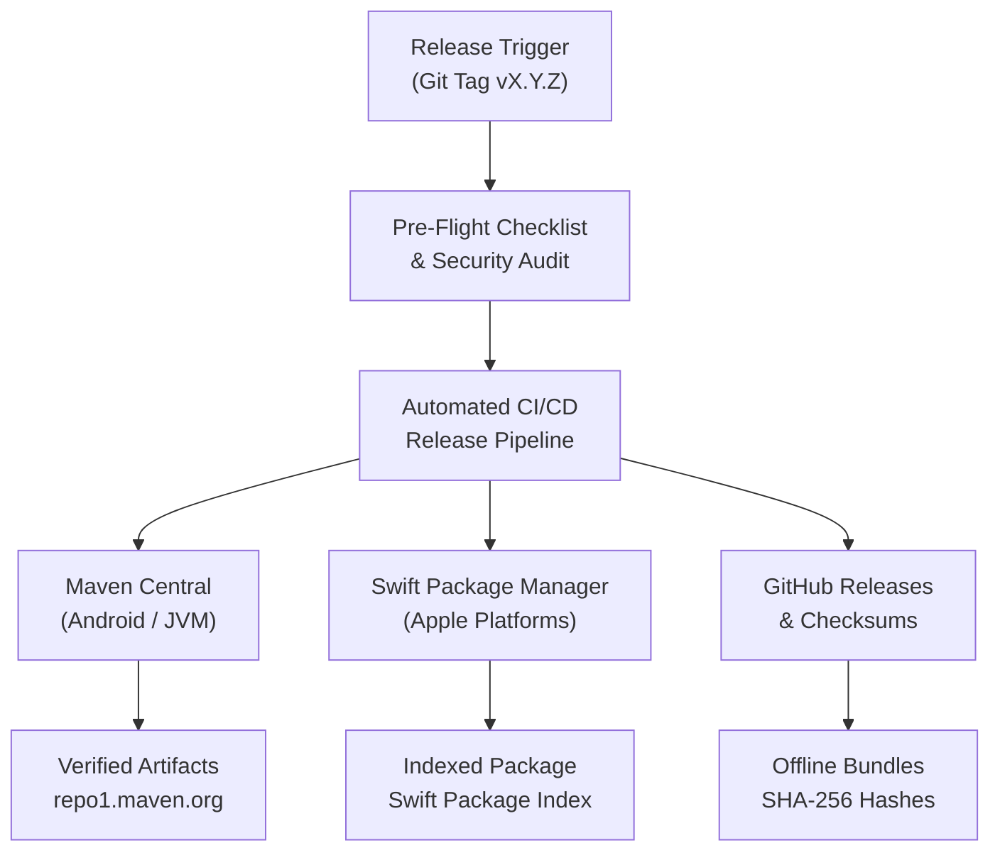

# Package Distribution & Publishing Guide

This document defines the formal specification, operating procedure, and verification criteria for releasing and distributing AirDB artifacts across Android, JVM, and Apple platforms.

---

## 1. Publishing Specification Architecture

AirDB releases adhere to strict decentralization, cryptographic integrity, and zero-trust standards. Every release encompasses four standardized pillars:



### Pillar 1: Semantic Versioning and Changelog Standards
AirDB follows [Semantic Versioning 2.0.0](https://semver.org/) (`MAJOR.MINOR.PATCH`):
- `MAJOR`: Breaking architectural changes or wire protocol incompatibilities.
- `MINOR`: Backward-compatible new features, new transports, or cryptographic extensions.
- `PATCH`: Backward-compatible bug fixes, performance optimizations, and documentation updates.

All changes must be cataloged in `CHANGELOG.md` following [Keep a Changelog](https://keepachangelog.com/en/1.1.0/) standards under six explicit categories:
- `Added`: New features, transports, or capabilities.
- `Changed`: Functional changes in existing behavior or interface refinements.
- `Deprecated`: Capabilities scheduled for removal in future major versions.
- `Removed`: Previously deprecated capabilities eliminated in this release.
- `Fixed`: Bug fixes, race condition patches, or leak resolutions.
- `Security`: Vulnerability mitigations, cryptographic upgrades, or verification audits.

### Pillar 2: Standardized Release Notes
Public release announcements on GitHub Releases must adhere to the following schema:
1. **Executive Summary**: 1 to 2 paragraphs outlining the core architectural objective of the release.
2. **Platform Coordinates**: Exact dependency lines for Gradle (Kotlin/Groovy) and Swift Package Manager.
3. **Quickstart Snippets**: Working initialization examples for Android/Kotlin and iOS/Swift.
4. **Cryptographic Provenance**: Fingerprint of the signing key and SHA-256 checksums of all release binaries.
5. **Documentation & Specification Links**: Direct references to official guides, manuals, and `llms.txt`.

### Pillar 3: Multi-Platform Artifact Inventory

#### A. Maven Central (JVM & Android)
Under the verified namespace `io.github.untacorp`, the following 9 artifacts are published:
- `io.github.untacorp:airdb-core`
- `io.github.untacorp:airdb-crypto`
- `io.github.untacorp:airdb-protocol`
- `io.github.untacorp:airdb-adapter-api`
- `io.github.untacorp:airdb-adapter-sqlite`
- `io.github.untacorp:airdb-adapter-aerolog`
- `io.github.untacorp:airdb-transport-api`
- `io.github.untacorp:airdb-transport-ble`
- `io.github.untacorp:airdb-transport-sim`

Each artifact provides:
- Binary JAR (`.jar`)
- Sources JAR (`-sources.jar`)
- Javadoc JAR (`-javadoc.jar`)
- Maven Project Object Model (`.pom`)
- Gradle Module Metadata (`.module`)
- PGP Detached Signatures (`.asc`) for all components
- Checksums (`.md5`, `.sha1`, `.sha256`, `.sha512`)

#### B. Swift Package Manager (Apple Platforms)
Distributed directly via Git release tags on the primary repository:
- Repository URL: `https://github.com/untacorp/airdb.git`
- Package definition: `Package.swift` at repo root exposing library `AirDbKit`.
- Supported platforms: iOS 16.0+, macOS 13.0+, tvOS 16.0+, watchOS 9.0+, visionOS 1.0+.
- Zero third-party dependencies: Built exclusively against standard Apple frameworks (`Foundation`, `CryptoKit`, `CoreBluetooth`, `libsqlite3`).

#### C. GitHub Release Assets
- `airdb-maven-bundle-X.Y.Z.zip`: Complete offline deployment bundle containing all 9 Maven Central modules.
- `SHA256SUMS.txt`: Cryptographic checksum file for all attached binaries.

---

## 2. Standard Operating Procedure (Release Checklist)

Follow this step-by-step checklist for every official release:

### Phase 1: Pre-Flight Verification (Local)
1. **Verify Clean Working Tree**:
   Ensure all changes are committed and working tree is clean.
   ```bash
   git status
   ```
2. **Execute Full Test Suite**:
   Run all JVM and Android BLE driver unit tests:
   ```bash
   ./gradlew test
   ```
3. **Execute Apple Test Suite**:
   Run all Swift unit tests:
   ```bash
   cd AirDbKit && swift test && cd ..
   ```
4. **Audit Zero-Emoji Compliance**:
   Run the repository emoji compliance validator:
   ```bash
   python3 -c '
   import re, subprocess, sys
   pattern = re.compile(r"[\U0001F600-\U0001F64F\U0001F300-\U0001F5FF\U0001F680-\U0001F6FF\U0001F1E0-\U0001F1FF\U00002702-\U000027B0\U0001F900-\U0001F9FF\U0001FA70-\U0001FAFF]")
   files = subprocess.check_output(["git", "ls-files"]).decode("utf-8").splitlines()
   violations = [f for f in files if any(pattern.findall(open(f, "r", errors="ignore").read()))]
   if violations:
       print("Emoji violations in:", violations); sys.exit(1)
   print("Zero-emoji audit passed.")
   '
   ```

### Phase 2: Version Bump & Changelog Update
1. **Update `build.gradle.kts`**:
   Set `version = "X.Y.Z"` across all published subprojects.
2. **Update `CHANGELOG.md`**:
   Promote the `[Unreleased]` section to `[X.Y.Z] - YYYY-MM-DD`.
3. **Commit Version Bump**:
   ```bash
   git add build.gradle.kts CHANGELOG.md
   git commit -m "chore(release): prepare vX.Y.Z"
   git push origin main
   ```

### Phase 3: Tagging and Automated Pipeline Trigger
1. **Create Annotated Git Tag**:
   ```bash
   git tag -a vX.Y.Z -m "Release vX.Y.Z: Summary of release"
   git push origin vX.Y.Z
   ```
2. **Automated CI/CD Execution**:
   GitHub Actions workflow `.github/workflows/publish.yml` triggers automatically upon tag push:
   - Compiles and signs all 8 JVM modules using the in-memory PGP key.
   - Packages a clean Central bundle without local repository metadata files.
   - Uploads bundle to the Sonatype Central Publisher API (`central.sonatype.com`).
   - Creates the official GitHub Release with generated release notes and attached offline bundle.

### Phase 4: Post-Release Verification
1. **Check Sonatype Central Portal**:
   Navigate to [central.sonatype.com](https://central.sonatype.com) and confirm the deployment status is `PUBLISHED`.
2. **Verify Maven Central Index**:
   Within 15-30 minutes, confirm availability on `repo1.maven.org`:
   ```bash
   curl -s "https://repo1.maven.org/maven2/io/github/untacorp/airdb-core/X.Y.Z/airdb-core-X.Y.Z.pom" | grep "<version>X.Y.Z</version>"
   ```
3. **Verify Swift Package Manager Resolution**:
   Open Xcode or create a test Swift package declaring:
   ```swift
   .package(url: "https://github.com/untacorp/airdb.git", from: "X.Y.Z")
   ```
   Execute `swift package resolve` to verify flawless dependency resolution.

---

## 3. Cryptographic Key Management

AirDB release artifacts are cryptographically signed to guarantee authenticity:
- **Key ID**: `CEB164B84F724DCC`
- **Key Fingerprint**: `11FF 32A2 9FE9 E6E3 14A4 8894 CEB1 64B8 4F72 4DCC`
- **Identity**: `Agus Arya <kadekaguspnata@gmail.com>`
- **Key Algorithm**: Ed25519 (Signing / Certifying)
- **Public Keyserver Registrations**:
  - `keyserver.ubuntu.com`
  - `keys.openpgp.org`

### Verifying Signatures Locally
To verify any published `.jar` or `.pom` file against the public key:
```bash
# Retrieve public key
gpg --keyserver keyserver.ubuntu.com --recv-keys CEB164B84F724DCC

# Verify detached signature
gpg --verify airdb-core-0.2.0.jar.asc airdb-core-0.2.0.jar
```
An exit code of `0` and output showing `Good signature from "Agus Arya <kadekaguspnata@gmail.com>"` confirms artifact authenticity and absence of tampering.
