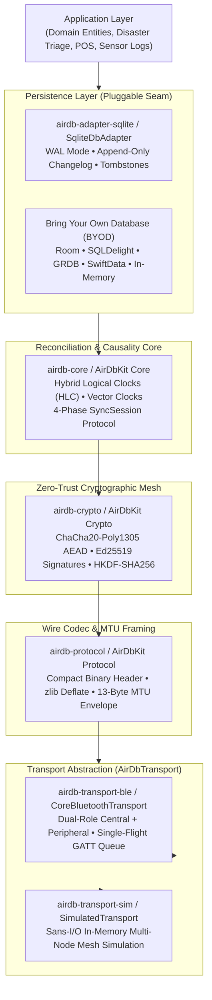

# AirDB Documentation

**Decentralized, Local-First Database Synchronization over Bluetooth Low Energy**

*Zero Internet. Zero Central Servers. Automatic Peer Reconciliation. Cryptographic Provenance.*

---

## Welcome to AirDB

**AirDB** is an open-source, local-first database replication engine designed for off-grid operations. When mobile devices running AirDB enter Bluetooth Low Energy (BLE) proximity (~10–30 meters), they automatically discover each other, negotiate causal state differences, and stream database mutations directly device-to-device.

Whether you are coordinating emergency disaster relief in camps without cellular towers, running pop-up POS cash registers at an outdoor festival, or syncing wildlife conservation logs in national parks, AirDB ensures your data stays synchronized without needing an internet connection.

---

## Quick Navigation

| Section | Core Topics | Recommended Audience |
| :--- | :--- | :--- |
| **[About AirDB](about/index.md)** | Introduction, Architectural Philosophy, Feature Inventory, FAQ | Engineers evaluating off-grid P2P synchronization |
| **[Getting Started](getting-started/index.md)** | 5-Minute Quickstart, Apple `AirDbKit` Guide, Disaster Triage App | Developers integrating AirDB into Android or iOS apps |
| **[Engine Manual](manual/index.md)** | Storage Adapters (Room, SQLite, GRDB), HLC Causality, Crypto Mesh, BLE | Architects exploring replication internals & wire codecs |
| **[Community & Governance](community/contributing.md)** | Coding Standards, Architecture Decision Records (ADRs), Publishing | Contributors building features or auditing protocols |
| **[Reference](reference/wire-spec.md)** | Binary Packet Specifications, Wire Codecs, API Contracts | Low-level developers and protocol auditors |

- **[About AirDB](about/index.md)**: What AirDB is, how it compares to centralized databases and chat mesh apps, and key concepts to know before you start.
- **[Getting Started](getting-started/index.md)**: Add AirDB to your Android or Apple project, follow the 5-minute quickstart, or build a complete disaster triage application.
- **[Engine Manual](manual/index.md)**: Deep dive into the persistence seam (Room, SQLite, GRDB, SwiftData), causality algorithms, the Zero-Trust security mesh, and BLE transports.
- **[Community & Contributing](community/contributing.md)**: Contribution guidelines, coding standards, Architecture Decision Records (ADRs), and package publishing.
- **[Reference](reference/wire-spec.md)**: Formal binary packet layouts and API contracts for Kotlin and Swift.

---

## Architecture at a Glance

---

## Acknowledgements & Prior Art

AirDB's protocols and architecture were informed by foundational research across distributed systems, local-first software, and wireless networking:

- **BitChat**: For proving the viability of mobile Bluetooth Low Energy (BLE) store-and-forward mesh communication. AirDB provides a clean-room implementation focused on structured database replication and causal consistency (CRDT/HLC) rather than ephemeral messaging.
- **Hybrid Logical Clocks (HLC)**: Based on *"Logical Physical Clocks and Consistent Snapshots in Globally Distributed Databases"* by Sandeep Kulkarni, Murat Demirbas, David Madeppa, Bharath Balasubramanian, and Sugumar Radhakrishnan (2014).
- **Vector Clocks & Distributed Ordering**: Grounded in the research of Leslie Lamport (1978), Colin Fidge (1988), and Friedemann Mattern (1988).
- **The Local-First Movement**: Inspired by *"Local-First Software: You Own Your Data, in spite of the Cloud"* by Martin Kleppmann, Adam Wiggins, Peter van Hardenberg, and Mark McGranaghan (Ink & Switch, 2019).
- **SQLite Engine**: Informed by D. Richard Hipp's architectural principles of crash resilience, Write-Ahead Logging (WAL), and zero-dependency embedded persistence.
- **Cryptographic RFC Standards**: RFC 8439 (ChaCha20-Poly1305 AEAD), RFC 8032 (Ed25519 Signatures), and RFC 5869 (HKDF-SHA256).

---

## License

AirDB is open-source software licensed under the **Apache License, Version 2.0**.
