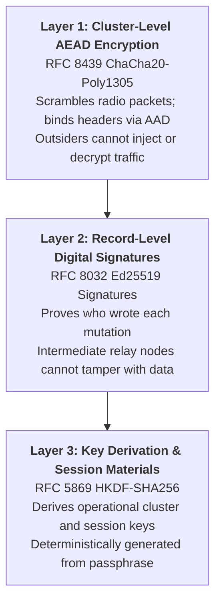
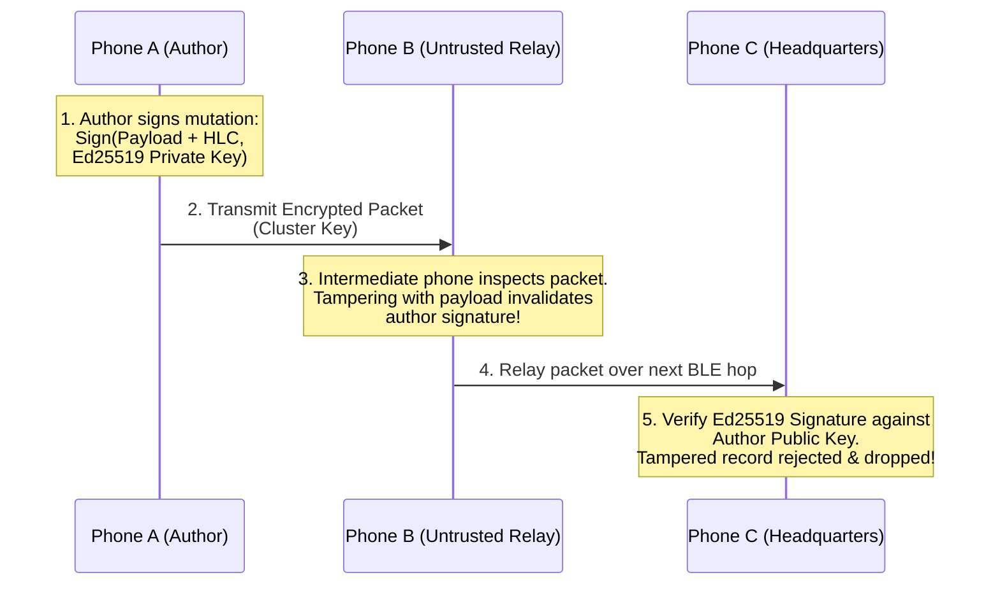

# Security & Zero-Trust Cryptographic Mesh

In a distributed mesh network, data doesn't just travel point-to-point. Packets often bounce across intermediate volunteer phones before reaching their final destination.

In emergency response camps or outdoor markets, those intermediate devices might be untrusted, running modified software, or accidentally misconfigured. AirDB uses a **Zero-Trust Cryptographic Mesh** to ensure that data remains private and impossible to tamper with.



---

## Layer 1: Over-the-Air Cluster Encryption (ChaCha20-Poly1305)

When devices communicate over Bluetooth Low Energy, anyone nearby with a radio packet sniffer could potentially listen in.

AirDB uses **RFC 8439 ChaCha20-Poly1305 AEAD** (Authenticated Encryption with Associated Data) with a 256-bit cluster key:

1. **Confidentiality**: All payload bytes (names, medical records, sales data) are encrypted on the wire.
2. **Fresh Nonce per Packet**: A fresh, random 12-byte CSPRNG nonce is generated for every transmission to prevent replay attacks.
3. **Header Authentication Binding (AAD)**: The entire packet header—including the sender ID, timestamp, and packet type—is passed as Authenticated Additional Data ($AAD$) into the Poly1305 authenticator.

> [!NOTE]
> If an attacker tampers with the sender ID or flips a single bit in the header, the Poly1305 MAC check immediately fails. AirDB drops the corrupted packet before attempting to parse it.

---

## Layer 2: Record-Level Digital Signatures (Ed25519)

Cluster encryption protects data *between immediate radio peers*. But what happens in a multi-hop mesh where Device A hands a packet to volunteer Device B to deliver to headquarters Device C?

Device B decrypts the radio packet to inspect where it should be routed. If Device B is malicious, could it alter a survivor's name or fake a medicine inventory count?

**No.** AirDB stops this with **RFC 8032 Ed25519 digital signatures**:

1. **Canonical Signing**: When Doctor Budi saves a record on Phone A, Phone A bundles:
   ```
   DataToSign = collection + id + mutation_type + hlc_timestamp + payload
   ```
2. **Author Signature**: Phone A signs this data using its private Ed25519 key, attaching its 32-byte public key and 64-byte signature to the record.
3. **Relay Verification**: When Headquarters Phone C receives the record, it checks the digital signature against Doctor Budi's public key.

If an intermediate phone altered the payload, modified the timestamp, or faked an edit, the cryptographic math fails and Phone C rejects the mutation immediately. The fake record is never written to disk or shared further.



---

## Layer 3: Key Derivation (HKDF-SHA256)

Rather than managing complex raw 32-byte hexadecimal keys, teams can share a human-readable cluster passphrase. AirDB uses **RFC 5869 HKDF-SHA256** to derive cryptographically secure keys:

=== "Kotlin"

    ```kotlin
    import io.airdb.crypto.HkdfSha256

    val clusterKey = HkdfSha256.deriveKey(
        ikm = "merapi-relief-camp-2026".toByteArray(Charsets.UTF_8),
        salt = "airdb-v1".toByteArray(Charsets.UTF_8),
        info = "cluster-aead-key".toByteArray(Charsets.UTF_8)
    )
    ```

=== "Swift"

    ```swift
    import AirDbKit

    let clusterKey = try HkdfSha256.deriveKey(
        secret: "merapi-relief-camp-2026".data(using: .utf8)!,
        salt: "airdb-v1".data(using: .utf8)!,
        info: "cluster-aead-key".data(using: .utf8)!
    )
    ```

---

## Summary of Guarantees

| Attack Vector | Defense Mechanism | Result |
|---|---|---|
| **Eavesdropping on BLE signals** | ChaCha20-Poly1305 AEAD | Attacker sees random bytes |
| **Injecting unauthorized packets** | Poly1305 MAC tag with header AAD | Packets dropped silently without parsing |
| **Replay attacks** | Fresh 12-byte CSPRNG nonces + HLC | Replayed packets rejected by timestamp |
| **Rogue intermediate relay node** | Ed25519 author digital signatures | Relays cannot forge or modify records |
