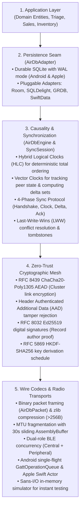

# AirDB Manual

Welcome to the AirDB technical manual. This section provides an in-depth look at how each layer of the engine operates.

---

## Architectural Map

AirDB is structured into five distinct, decoupled layers:

---

## Manual Chapters

- **[Storage & Bring Your Own Database (BYOD)](persistence/index.md)**: How AirDB interacts with local storage engines, and guides for SQLite, Room, SQLDelight, GRDB, SwiftData, and CoreData.
- **[How Synchronization Works](causality/how-sync-works.md)**: Deep dive into Hybrid Logical Clocks (HLC), vector clocks, the 4-phase synchronization handshake, and tombstone lifecycle.
- **[Security & Cryptographic Mesh](cryptography/security-mesh.md)**: How AirDB secures data over the air using ChaCha20-Poly1305 and guarantees record provenance across untrusted mesh relays with Ed25519 digital signatures.
- **[Networking & Bluetooth Transports](networking/wire-and-ble.md)**: How packets are framed, compressed, fragmented, and delivered over Bluetooth Low Energy without native driver race conditions.
- **[Testing Without Hardware](simulation/testing-with-simulator.md)**: How to use the Sans-I/O in-memory simulator to test multi-node sync topologies in automated test suites in milliseconds.
