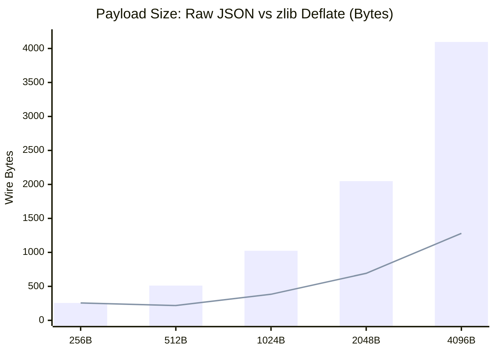
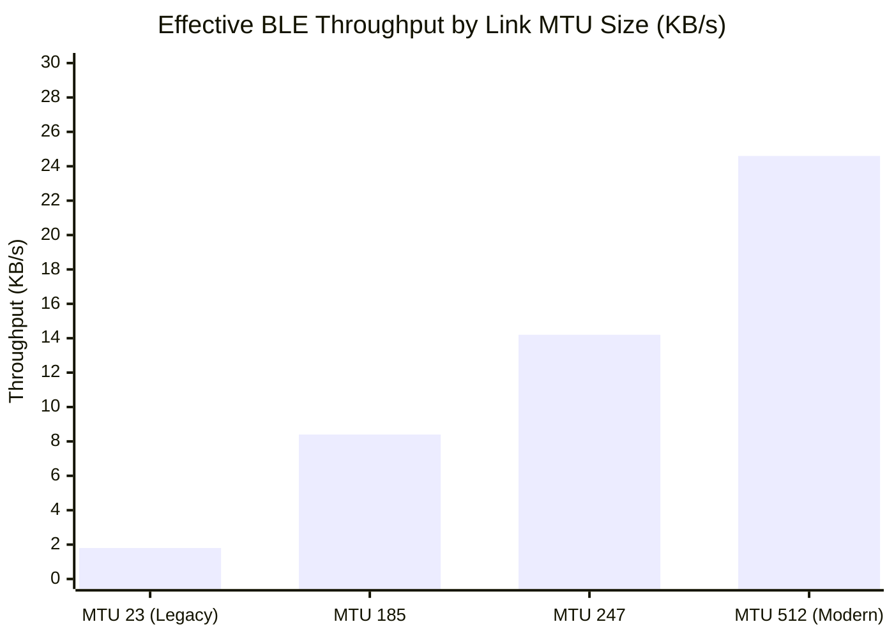

# Networking, Framing & BLE Transports

This chapter covers how AirDB packages data into binary frames, compresses large messages, splits packets across small Bluetooth Low Energy MTU limits, and manages hardware radios reliably.

---

## 1. Binary Packet Framing (`AirDbPacket`)

AirDB does not send heavy text formats like JSON or XML over raw Bluetooth radios. Instead, it serializes compact binary frames:

```
+------------+---------+------+-------+-----------+----------------+-----------+--------------------+
| Magic (2B) | Ver(1B) | Type | Flags | Timestamp | Payload Length | Sender ID | Recipient ID (opt) |
| 0x41 0x44  | 0x01    | 1B   | 1B    | 8B (Long) | 2B (UInt16)    | 8B (Long) | 8B (Long)          |
+------------+---------+------+-------+-----------+----------------+-----------+--------------------+
| Trailing Payload (0 to 65,535 bytes)                                                              |
+----------------------------------------------------------------------------------------------------+
```

### Key Header Fields
- **Magic (`0x41 0x44`)**: Fixed bytes representing ASCII `"AD"` for AirDB. Rejects stray packets from unrelated Bluetooth accessories or devices.
- **Type (1 byte)**: Indicates the message purpose (`HANDSHAKE`, `RECONCILE_REQ`, `DELTA_BATCH`, `DELTA_ACK`, etc.).
- **Flags (1 byte)**:
  - `0x01` (`FLAG_COMPRESSED`): Set if the payload was compressed with zlib Deflate.
  - `0x02` (`FLAG_HAS_RECIPIENT`): Set if an optional 8-byte recipient ID is included in the header.
  - `0x04` (`FLAG_ENCRYPTED`): Set if the payload is encrypted with ChaCha20-Poly1305.
- **Payload Length (2 bytes)**: Exact length of the payload in Big-Endian network byte order.

---

## 2. Automated Payload Compression

Bluetooth Low Energy radio airtime directly impacts device battery life. 

When a serialized payload exceeds **256 bytes**, AirDB automatically compresses it using **zlib Deflate** before transmission. On typical JSON records and delta batches, this achieves a **50% to 70% size reduction**, cutting radio transmission time and energy consumption significantly.



If a payload is smaller than 256 bytes, AirDB leaves it uncompressed to avoid compression overhead.

---

## 3. MTU Fragmentation & Reassembly

Standard Bluetooth Low Energy connections have a Maximum Transmission Unit (MTU) that is often bounded (typically between 180 and 512 bytes). If a batch of mutations is 2,000 bytes, sending it all at once causes the Bluetooth driver to drop it.



AirDB includes an automated chunking system:
1. If a packet exceeds the link's safe MTU threshold (default 460 bytes), it is sliced into fragments.
2. Each slice is wrapped in a 13-byte `FragmentHeader`:
   ```
   +--------------------+------------------+------------------+--------------------+------------+
   | Fragment ID (8B)   | Index (2B BE)    | Total (2B BE)    | Original Type (1B) | Chunk Data |
   +--------------------+------------------+------------------+--------------------+------------+
   ```
3. The receiving device buffers incoming chunks in an `AssemblyBuffer`.
4. Once all chunks arrive, they are assembled back into the original `AirDbPacket` and processed.

> [!TIP]
> **Sliding 30-Second TTL**: The `AssemblyBuffer` automatically purges incomplete fragment sets after 30 seconds. If a user walks away mid-transfer and connection drops, stale chunks will never leak device memory.

---

## 4. Concurrency: Solving the Android Bluetooth Queue Bug

A known issue in Android's native Bluetooth stack (Fluoride/BlueDroid) is that GATT operations are strictly **asynchronous and single-flight per connection**. 

If an application invokes `writeCharacteristic` while another write is still pending in the hardware stack, Android either drops the packet silently or throws an immediate `GATT_FAILURE` error.

AirDB solves this on Android with the **`GattOperationQueue`**:
- Every physical Bluetooth link maintains an isolated FIFO queue.
- When an operation is queued, it is only dispatched to the Android Bluetooth driver when the previous operation triggers the hardware confirmation callback (`onCharacteristicWrite` or `onNotificationSent`).
- If a transient radio error occurs, the queue automatically retries up to 3 times with exponential backoff before reporting a link failure.

On Apple platforms, `AirDbKit` runs the core engine inside a Swift `actor`, guaranteeing thread safety and asynchronous dispatch across CoreBluetooth delegate queues.

---

## 5. Dual-Role Radio Operation

In AirDB, devices do not act solely as clients or servers. Every device operates simultaneously in **dual roles**:
- **GATT Central**: Scans for advertisements from nearby peers.
- **GATT Peripheral**: Broadcasts its presence using a compact 31-byte advertising frame containing AirDB's 128-bit Service UUID.

This symmetric discovery ensures that any two phones approaching each other in the field can immediately establish a connection without requiring manual pairing or designated master nodes.
