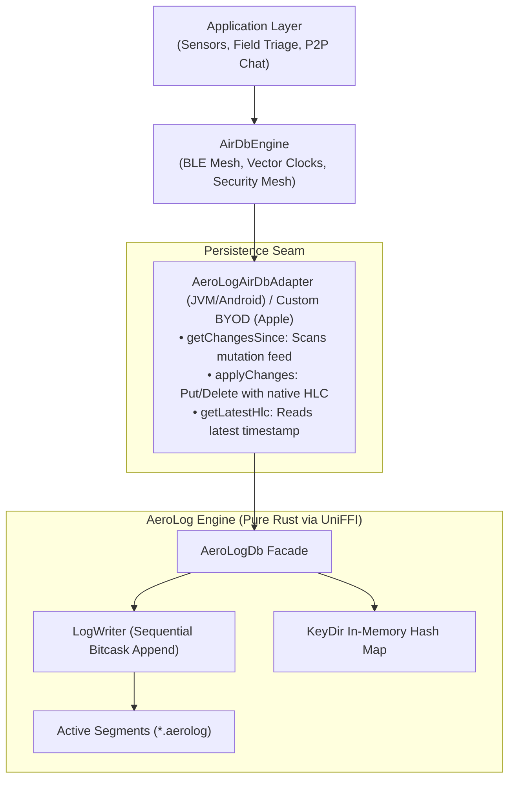

# AeroLog Storage Engine (Bitcask Log)

For high-throughput edge nodes, battery-critical mobile devices, and IoT hardware, AirDB can be paired with **AeroLog** as its local persistence engine.

[AeroLog](https://untacorp.github.io/aerolog/) is an open-source, universal, local-first storage engine written from first principles in pure **Rust**. While traditional mobile databases (like SQLite) use page-based B-Trees that suffer from heavy write amplification and random flash I/O, AeroLog implements an **Append-Only Bitcask Log** that delivers pure sequential disk writes exceeding **200,000 writes/sec** with hardware-accelerated CRC32 integrity checks.

---

## Why Pair AirDB with AeroLog?



1. **Extreme Sequential Write Throughput**: Over 200,000 writes/sec with zero random disk I/O, minimizing flash memory wear and significantly saving battery life during high-volume sync sessions.
2. **Native HLC Causality Alignment**: Both AirDB and AeroLog share the same Hybrid Logical Clock (HLC) physical-logical tuple model, allowing seamless causality preservation without format conversions.
3. **Instant Single-Seek Point Reads**: KeyDir in-memory index maps keys directly to exact file offsets and byte lengths, delivering point read latencies under 15 microseconds.
4. **Zero-Dependency Native Safety**: Zero garbage-collection pauses, memory safety guaranteed by Rust, and byte-for-byte binary parity across Android, JVM, iOS, and macOS via Mozilla UniFFI.

---

## Architectural Comparison

| Architectural Property | Built-in SQLite | AeroLog Engine |
| :--- | :--- | :--- |
| **Storage Architecture** | B-Tree with Write-Ahead Logging (WAL) | Append-Only Bitcask Log |
| **Write Throughput** | ~14,000 to 16,000 ops/sec | **> 200,000 ops/sec** |
| **Disk I/O Pattern** | Page-level updates (write amplification) | **100% Sequential Appends** |
| **NAND Flash Wear** | Moderate to High | **Minimal (Preserves Flash Lifetime)** |
| **Point Read Latency** | B-Tree page traversal (~40 to 80 µs) | In-memory `KeyDir` seek (**~13 µs**) |
| **Causality Model** | Stored as text columns in SQL | **Native Monotonic HLC Tuple** |
| **Data Integrity** | Page-level checksums | **Hardware CRC32-IEEE per Record** |
| **Ideal Workloads** | Relational SQL queries, joins, foreign keys | High-frequency telemetry, P2P logs, IoT |

---

## Platform Architecture & Ecosystem Integration

AirDB provides two distinct deployment models for AeroLog persistence:

1. **Android & JVM (`airdb-adapter-aerolog`)**: First-class turnkey adapter artifact (`AeroLogAirDbAdapter`) built on `AbstractAirDbAdapter`. Bundles precompiled AeroLog UniFFI dynamic libraries (`libaerolog_uniffi.so`, `libaerolog_uniffi.dylib`) across Linux, macOS, and Android architectures.
2. **Apple Platforms (`AirDbKit` BYOD Seam)**: In accordance with **Invariant 6** (`AirDbKit` maintains zero third-party SPM dependencies and relies strictly on Apple system frameworks), `AirDbKit` ships natively with `SqliteDbAdapter`. Applications wishing to use AeroLog on iOS or macOS can link the UniFFI Rust binary at the application layer and implement the `AirDbAdapter` protocol via the BYOD pattern.

---

## Implementing `AirDbAdapter` with AeroLog

### Kotlin (Android / JVM)

The official `airdb-adapter-aerolog` module provides `AeroLogAirDbAdapter`, implementing `AbstractAirDbAdapter` with automatic Last-Write-Wins (LWW) reconciliation, in-memory KeyDir indexing, changelog streams, and Bitcask compaction:

```kotlin
// build.gradle.kts
dependencies {
    implementation("io.airdb:airdb-core:0.2.0")
    implementation("io.airdb:airdb-adapter-aerolog:0.2.0")
}
```

```kotlin
package io.airdb.demo

import io.airdb.adapter.aerolog.AeroLogAirDbAdapter
import io.airdb.core.engine.AirDbEngine
import io.airdb.transport.ble.AndroidBleTransport
import java.io.File

// Initialize AeroLog storage in app sandbox directory
val storageDirectory = File(context.filesDir, "aerolog_data")
val adapter = AeroLogAirDbAdapter.open(storageDirectory, nodeId = "node-alpha")

// Connect persistence adapter to AirDbEngine
val engine = AirDbEngine(
    nodeName = "node-alpha",
    adapter = adapter,
    transport = AndroidBleTransport(context)
)

engine.start()
```

### Swift (Apple Platforms - BYOD Pattern)

Applications targeting iOS or macOS that link the AeroLog UniFFI library can conform their wrapper to `AirDbAdapter` directly at the application layer:

```swift
import Foundation
import AirDbKit

public final class AeroLogDbAdapter: AirDbAdapter, @unchecked Sendable {
    private let database: FfiAeroLogDb

    public init(database: FfiAeroLogDb) {
        self.database = database
    }

    public func getChangesSince(
        sinceHlcTimestamp: String?,
        limit: Int
    ) async throws -> [ChangeRecord] {
        var physicalTime: UInt64? = nil
        var logicalCounter: UInt16? = nil
        var nodeHash: UInt64? = nil

        if let hlc = sinceHlcTimestamp {
            let parts = hlc.split(separator: "-")
            if parts.count >= 3 {
                physicalTime = UInt64(parts[0])
                logicalCounter = UInt16(parts[1])
                nodeHash = UInt64(parts[2])
            }
        }

        let mutations = try database.scanMutationsSince(
            sincePhysicalTime: physicalTime,
            sinceLogicalCounter: logicalCounter,
            sinceNodeHash: nodeHash,
            limit: UInt32(limit)
        )

        return mutations.map { mutation in
            let keyParts = mutation.key.split(separator: ":", maxSplits: 1)
            let collection = keyParts.first.map(String.init) ?? "default"
            let id = keyParts.count > 1 ? String(keyParts[1]) : mutation.key

            return ChangeRecord(
                id: id,
                collection: collection,
                type: mutation.recordType == 1 ? .delete : .put,
                payload: mutation.payload,
                hlcTimestamp: mutation.hlcString
            )
        }
    }

    public func applyChanges(_ changes: [ChangeRecord]) async throws {
        for change in changes {
            let parts = change.hlcTimestamp.split(separator: "-")
            let physicalTime = parts.count > 0 ? (UInt64(parts[0]) ?? 0) : 0
            let logicalCounter = parts.count > 1 ? (UInt16(parts[1]) ?? 0) : 0
            let nodeHash = parts.count > 2 ? (UInt64(parts[2]) ?? 0) : 0

            if change.mutationType == .delete {
                _ = try database.delete(collection: change.collection, key: change.id)
            } else {
                _ = try database.putWithHlc(
                    collection: change.collection,
                    key: change.id,
                    value: change.payload,
                    physicalTime: physicalTime,
                    logicalCounter: logicalCounter,
                    nodeIdHash: nodeHash
                )
            }
        }
    }

    public func getLatestHlc() async throws -> String? {
        let recent = try database.scanMutationsSince(
            sincePhysicalTime: nil,
            sinceLogicalCounter: nil,
            sinceNodeHash: nil,
            limit: 1
        )
        return recent.first?.hlcString
    }
}
```

---

## Resources & Documentation

To learn more about AeroLog's internal Bitcask architecture, zero-dependency CBOR codecs, and dual-tier sparse indexing:

- **Official Documentation**: [https://untacorp.github.io/aerolog/](https://untacorp.github.io/aerolog/)
- **GitHub Repository**: [https://github.com/untacorp/aerolog](https://github.com/untacorp/aerolog)
- **Binary Format Specification**: [AeroLog Binary Layout](https://untacorp.github.io/aerolog/reference/binary-spec/)
- **Engine Manual**: [Bitcask Append-Only Storage](https://untacorp.github.io/aerolog/manual/storage/bitcask-log/)
