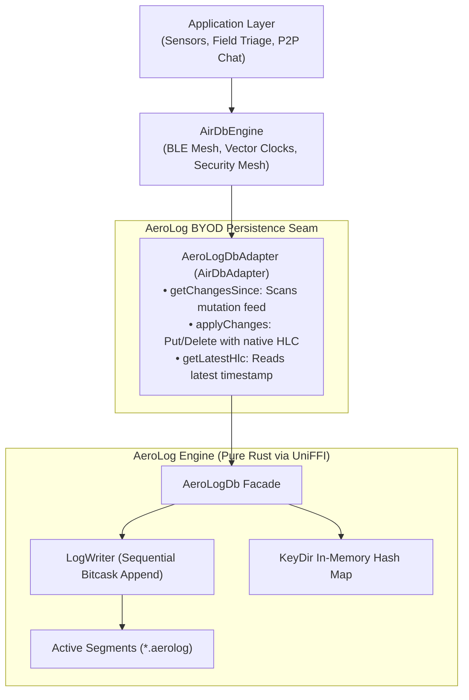

# AeroLog Storage Engine (Bitcask Log)

For high-throughput edge nodes, battery-critical mobile devices, and IoT hardware, AirDB can be paired with **AeroLog** as its local persistence engine.

[AeroLog](https://untacorp.github.io/aerolog/) is an open-source, universal, local-first storage engine written from first principles in pure **Rust**. While traditional mobile databases (like SQLite) use page-based B-Trees that suffer from heavy write amplification and random flash I/O, AeroLog implements an **Append-Only Bitcask Log** that delivers pure sequential disk writes exceeding **200,000 writes/sec** with hardware-accelerated CRC32 integrity checks.

---

## Why Pair AirDB with AeroLog?



1. **Extreme Sequential Write Throughput**: Over 200,000 writes/sec with zero random disk I/O, minimizing flash memory wear and significantly saving battery life during high-volume sync sessions.
2. **Native HLC Causality Alignment**: Both AirDB and AeroLog share the same Hybrid Logical Clock (HLC) physical-logical tuple model, allowing seamless causality preservation without format conversions.
3. **Instant Single-Seek Point Reads**: KeyDir in-memory index maps keys directly to exact file offsets and byte lengths, delivering point read latencies under 15 microseconds.
4. **Zero-Dependency Native Safety**: Zero garbage-collection pauses, memory safety guaranteed by Rust, and byte-for-byte binary parity across Android, JVM, iOS, and macOS via Mozilla UniFFI.

---

## Architectural Comparison

| Architectural Property | Built-in SQLite | AeroLog Engine |
| :--- | :--- | :--- |
| **Storage Architecture** | B-Tree with Write-Ahead Logging (WAL) | Append-Only Bitcask Log |
| **Write Throughput** | ~14,000 to 16,000 ops/sec | **> 200,000 ops/sec** |
| **Disk I/O Pattern** | Page-level updates (write amplification) | **100% Sequential Appends** |
| **NAND Flash Wear** | Moderate to High | **Minimal (Preserves Flash Lifetime)** |
| **Point Read Latency** | B-Tree page traversal (~40 to 80 µs) | In-memory `KeyDir` seek (**~13 µs**) |
| **Causality Model** | Stored as text columns in SQL | **Native Monotonic HLC Tuple** |
| **Data Integrity** | Page-level checksums | **Hardware CRC32-IEEE per Record** |
| **Ideal Workloads** | Relational SQL queries, joins, foreign keys | High-frequency telemetry, P2P logs, IoT |

---

## Implementing `AirDbAdapter` with AeroLog

Connecting AeroLog to AirDB requires implementing the four core methods of `AirDbAdapter`:

### Kotlin (Android / JVM)

```kotlin
package io.airdb.adapter.aerolog

import io.airdb.adapter.AirDbAdapter
import io.airdb.model.ChangeRecord
import io.airdb.model.MutationType
import io.aerolog.uniffi.FfiAeroLogDb
import io.aerolog.uniffi.FfiMutationRecord

class AeroLogDbAdapter(
    private val db: FfiAeroLogDb
) : AirDbAdapter {

    override suspend fun getChangesSince(
        sinceHlcTimestamp: String?,
        limit: Int
    ): List<ChangeRecord> {
        // Parse sinceHlcTimestamp into physical and logical components
        val parts = sinceHlcTimestamp?.split("-")
        val physical = parts?.getOrNull(0)?.toULongOrNull()
        val logical = parts?.getOrNull(1)?.toUShortOrNull()
        val nodeHash = parts?.getOrNull(2)?.toULongOrNull()

        val mutations = db.scanMutationsSince(
            sincePhysicalTime = physical,
            sinceLogicalCounter = logical,
            sinceNodeHash = nodeHash,
            limit = limit.toUInt()
        )

        return mutations.map { mut ->
            ChangeRecord(
                collection = mut.key.substringBefore(":"),
                id = mut.key.substringAfter(":"),
                mutationType = if (mut.recordType == 1.toUByte()) MutationType.DELETE else MutationType.PUT,
                payload = mut.payload,
                hlcTimestamp = mut.hlcString
            )
        }
    }

    override suspend fun applyChanges(changes: List<ChangeRecord>) {
        for (change in changes) {
            val parts = change.hlcTimestamp.split("-")
            val pt = parts.getOrNull(0)?.toULongOrNull() ?: 0UL
            val lc = parts.getOrNull(1)?.toUShortOrNull() ?: 0U
            val nh = parts.getOrNull(2)?.toULongOrNull() ?: 0UL

            if (change.mutationType == MutationType.DELETE) {
                db.delete(change.collection, change.id)
            } else {
                db.putWithHlc(
                    collection = change.collection,
                    key = change.id,
                    value = change.payload,
                    physicalTime = pt,
                    logicalCounter = lc,
                    nodeIdHash = nh
                )
            }
        }
    }

    override suspend fun getLatestHlc(): String? {
        val recent = db.scanMutationsSince(null, null, null, 1U)
        return recent.firstOrNull()?.hlcString
    }
}
```

### Swift (Apple Platforms)

```swift
import AirDbKit
import AeroLogUniFFI
import Foundation

public final class AeroLogDbAdapter: AirDbAdapter, @unchecked Sendable {
    private let db: FfiAeroLogDb

    public init(database: FfiAeroLogDb) {
        self.db = database
    }

    public func getChangesSince(
        sinceHlcTimestamp: String?,
        limit: Int
    ) async throws -> [ChangeRecord] {
        var pt: UInt64? = nil
        var lc: UInt16? = nil
        var nh: UInt64? = nil

        if let hlc = sinceHlcTimestamp {
            let parts = hlc.split(separator: "-")
            if parts.count >= 3 {
                pt = UInt64(parts[0])
                lc = UInt16(parts[1])
                nh = UInt64(parts[2])
            }
        }

        let mutations = try db.scanMutationsSince(
            sincePhysicalTime: pt,
            sinceLogicalCounter: lc,
            sinceNodeHash: nh,
            limit: UInt32(limit)
        )

        return mutations.map { mut in
            let keyParts = mut.key.split(separator: ":", maxSplits: 1)
            let col = keyParts.first.map(String.init) ?? "default"
            let id = keyParts.count > 1 ? String(keyParts[1]) : mut.key

            return ChangeRecord(
                collection: col,
                id: id,
                mutationType: mut.recordType == 1 ? .delete : .put,
                payload: mut.payload,
                hlcTimestamp: mut.hlcString
            )
        }
    }

    public func applyChanges(_ changes: [ChangeRecord]) async throws {
        for change in changes {
            let parts = change.hlcTimestamp.split(separator: "-")
            let pt = parts.count > 0 ? (UInt64(parts[0]) ?? 0) : 0
            let lc = parts.count > 1 ? (UInt16(parts[1]) ?? 0) : 0
            let nh = parts.count > 2 ? (UInt64(parts[2]) ?? 0) : 0

            if change.mutationType == .delete {
                _ = try db.delete(collection: change.collection, key: change.id)
            } else {
                _ = try db.putWithHlc(
                    collection: change.collection,
                    key: change.id,
                    value: change.payload,
                    physicalTime: pt,
                    logicalCounter: lc,
                    nodeIdHash: nh
                )
            }
        }
    }

    public func getLatestHlc() async throws -> String? {
        let recent = try db.scanMutationsSince(
            sincePhysicalTime: nil,
            sinceLogicalCounter: nil,
            sinceNodeHash: nil,
            limit: 1
        )
        return recent.first?.hlcString
    }
}
```

---

## Resources & Documentation

To learn more about AeroLog's internal Bitcask architecture, zero-dependency CBOR codecs, and dual-tier sparse indexing:

- **Official Documentation**: [https://untacorp.github.io/aerolog/](https://untacorp.github.io/aerolog/)
- **GitHub Repository**: [https://github.com/untacorp/aerolog](https://github.com/untacorp/aerolog)
- **Binary Format Specification**: [AeroLog Binary Layout](https://untacorp.github.io/aerolog/reference/binary-spec/)
- **Engine Manual**: [Bitcask Append-Only Storage](https://untacorp.github.io/aerolog/manual/storage/bitcask-log/)
