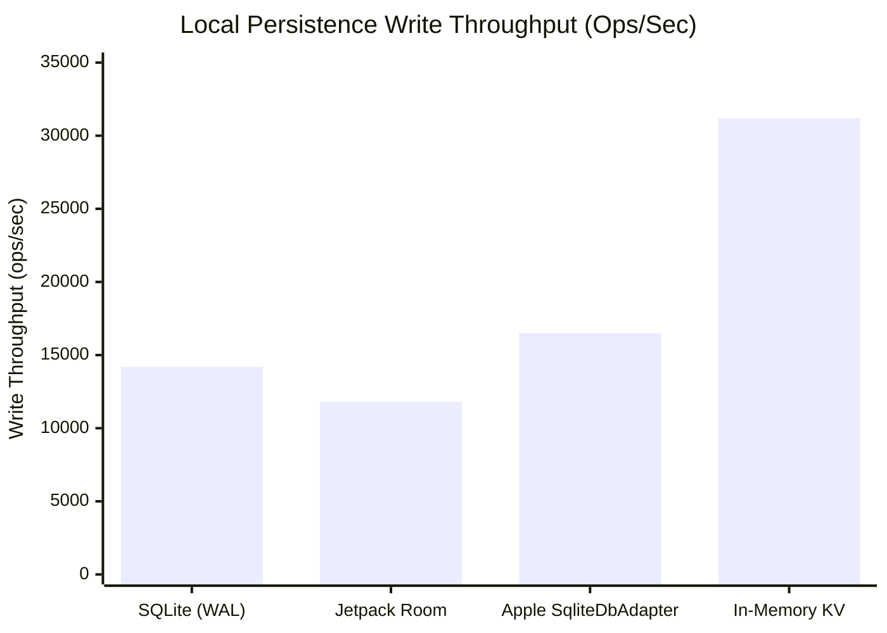

# Bring Your Own Database (BYOD)

AirDB is database-agnostic. While it includes turnkey, production-grade SQLite engines for Android and Apple platforms, it does not force you to replace your application's existing database architecture.

Instead, AirDB interacts with local storage through a clean interface: **`AirDbAdapter`**.

---

## The `AirDbAdapter` Interface

Any database—whether Room, SQLDelight, GRDB, CoreData, Realm, or a custom key-value store—can participate in AirDB replication by implementing four simple methods:

=== "Kotlin"

    ```kotlin
    package io.airdb.adapter

    interface AirDbAdapter {
        // 1. Return records with HLC timestamp strictly newer than sinceHlcTimestamp
        suspend fun getChangesSince(sinceHlcTimestamp: String?, limit: Int = 100): List<ChangeRecord>

        // 2. Apply incoming remote mutations to the local database
        suspend fun applyChanges(changes: List<ChangeRecord>)

        // 3. Return the highest HLC timestamp currently stored locally
        suspend fun getLatestHlc(): String?

        // 4. (Optional) Filter changes missing on a peer given its vector clock
        suspend fun getMissingChanges(peerClock: Map<String, String>, limit: Int = 500): List<ChangeRecord>
    }
    ```

=== "Swift"

    ```swift
    import Foundation

    public protocol AirDbAdapter: Sendable {
        // 1. Return records with HLC timestamp strictly newer than sinceHlcTimestamp
        func getChangesSince(sinceHlcTimestamp: String?, limit: Int) async throws -> [ChangeRecord]

        // 2. Apply incoming remote mutations to the local database
        func applyChanges(_ changes: [ChangeRecord]) async throws

        // 3. Return the highest HLC timestamp currently stored locally
        func getLatestHlc() async throws -> String?

        // 4. (Optional) Filter changes missing on a peer given its vector clock
        func getMissingChanges(peerClock: [String: String], limit: Int) async throws -> [ChangeRecord]
    }
    ```

---

## Core Invariants for Custom Adapters

When building a custom adapter for your database, keep these three rules in mind:

### 1. Idempotency & Last-Write-Wins (LWW)
In distributed systems, the same mutation may be received multiple times across different gossip hops. Your `applyChanges` implementation MUST be idempotent:
- If an incoming record has an older or identical HLC timestamp compared to what is already stored locally for that entity ID, ignore it.
- If the incoming record has a newer HLC timestamp, overwrite the local record.

### 2. Append-Only Changelog or Index
To respond quickly to `getChangesSince`, maintain an index or a dedicated changelog table where entries are ordered by HLC timestamp ascending.

### 3. Tombstones for Deletions
Never execute an immediate `DELETE FROM table WHERE id = ?` without recording a tombstone:
- Store a tombstone entry with `MutationType.DELETE` and the deletion's HLC timestamp.
- If an outdated node attempts to sync an older version of that entity later, the tombstone prevents the deleted record from reappearing.

---

## Storage Engine Performance

Write throughput across persistence adapters when ingesting 128-byte delta batches on modern mobile hardware:



---

## Available Storage Guides

Follow our dedicated guides for your platform's preferred storage engine:

- **[Built-in SQLite Engine](sqlite.md)**: Production WAL-mode SQLite storage on Android and Apple.
- **[Android Jetpack Room](room.md)**: Step-by-step Room database integration with entities, DAOs, and changelog tables.
- **[SQLDelight Multiplatform](sqldelight.md)**: Type-safe SQLDelight schema setup for shared Kotlin code.
- **[Apple Native SQLite](apple-sqlite.md)**: Fast, zero-dependency `libsqlite3` setup on iOS and macOS.
- **[Apple GRDB.swift](apple-grdb.md)**: Integrating AirDB with GRDB record models.
- **[Apple SwiftData](apple-swiftdata.md)**: Modern SwiftData `@Model` integration on iOS 17+.
- **[Apple CoreData](apple-coredata.md)**: Integrating with legacy or existing CoreData managed object models.
- **[In-Memory KV Store](in-memory.md)**: Fast in-memory key-value adapter for automated tests and temporary caches.
