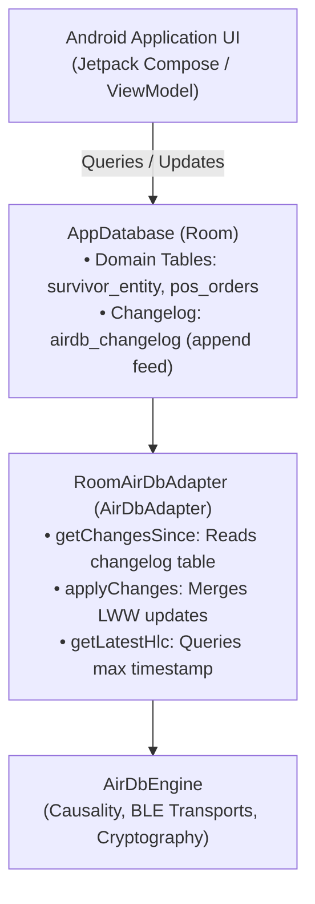

# Android Jetpack Room Integration

This guide demonstrates how to integrate AirDB into an existing Android application using **Android Jetpack Room**.

---

## Architecture Overview



---

## 1. Define the Changelog Entity

Add an append-only changelog entity alongside your domain entities in your Room database:

```kotlin
package com.example.app.data.local

import androidx.room.Entity
import androidx.room.Index
import androidx.room.PrimaryKey

@Entity(
    tableName = "airdb_changelog",
    indices = [
        Index(value = ["hlcTimestamp"], unique = false),
        Index(value = ["collection", "recordId"], unique = false)
    ]
)
data class ChangelogEntity(
    @PrimaryKey(autoGenerate = true)
    val localId: Long = 0,
    val collection: String,
    val recordId: String,
    val mutationType: String, // INSERT, UPDATE, DELETE
    val payload: ByteArray,
    val hlcTimestamp: String,
    val authorPublicKey: ByteArray? = null,
    val signature: ByteArray? = null,
    val createdAt: Long = System.currentTimeMillis()
)
```

---

## 2. Define the DAO

```kotlin
package com.example.app.data.local

import androidx.room.Dao
import androidx.room.Insert
import androidx.room.OnConflictStrategy
import androidx.room.Query

@Dao
interface ChangelogDao {

    @Query("SELECT * FROM airdb_changelog WHERE hlcTimestamp > :sinceHlc ORDER BY hlcTimestamp ASC LIMIT :limit")
    suspend fun getChangesSince(sinceHlc: String, limit: Int): List<ChangelogEntity>

    @Query("SELECT * FROM airdb_changelog ORDER BY hlcTimestamp ASC LIMIT :limit")
    suspend fun getAllChanges(limit: Int): List<ChangelogEntity>

    @Query("SELECT MAX(hlcTimestamp) FROM airdb_changelog")
    suspend fun getLatestHlc(): String?

    @Insert(onConflict = OnConflictStrategy.REPLACE)
    suspend fun insertAll(changes: List<ChangelogEntity>)
}
```

---

## 3. Implement the `AirDbAdapter`

```kotlin
package com.example.app.data.local

import io.airdb.adapter.AirDbAdapter
import io.airdb.adapter.ChangeRecord
import io.airdb.adapter.HlcComparator
import io.airdb.adapter.MutationType

class RoomAirDbAdapter(
    private val database: AppDatabase,
    private val changelogDao: ChangelogDao
) : AirDbAdapter {

    override suspend fun getChangesSince(sinceHlcTimestamp: String?, limit: Int): List<ChangeRecord> {
        val entities = if (sinceHlcTimestamp.isNullOrEmpty()) {
            changelogDao.getAllChanges(limit)
        } else {
            changelogDao.getChangesSince(sinceHlcTimestamp, limit)
        }
        return entities.map { it.toChangeRecord() }
    }

    override suspend fun applyChanges(changes: List<ChangeRecord>) {
        database.runInTransaction {
            // Apply each change to your domain tables using Last-Write-Wins
            for (change in changes) {
                // Insert into changelog for downstream gossip propagation
                // and update corresponding domain entity
            }
        }
    }

    override suspend fun getLatestHlc(): String? {
        return changelogDao.getLatestHlc()
    }
}
```
